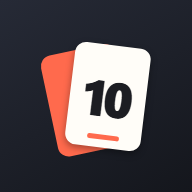
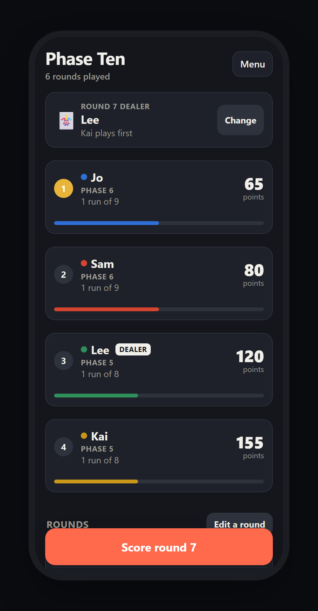
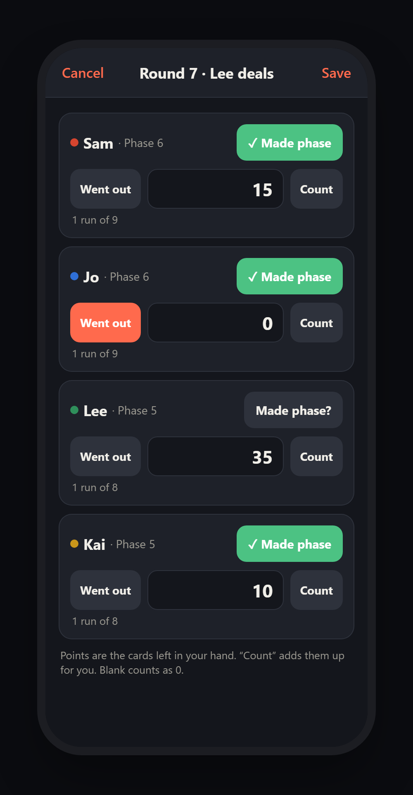
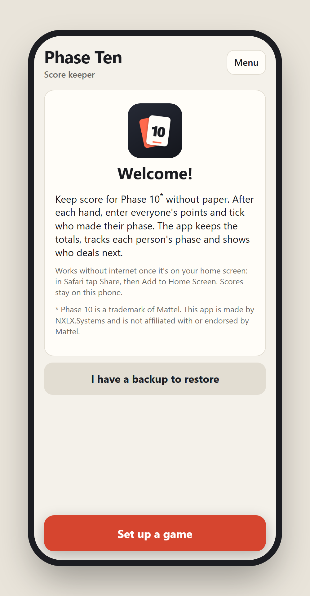
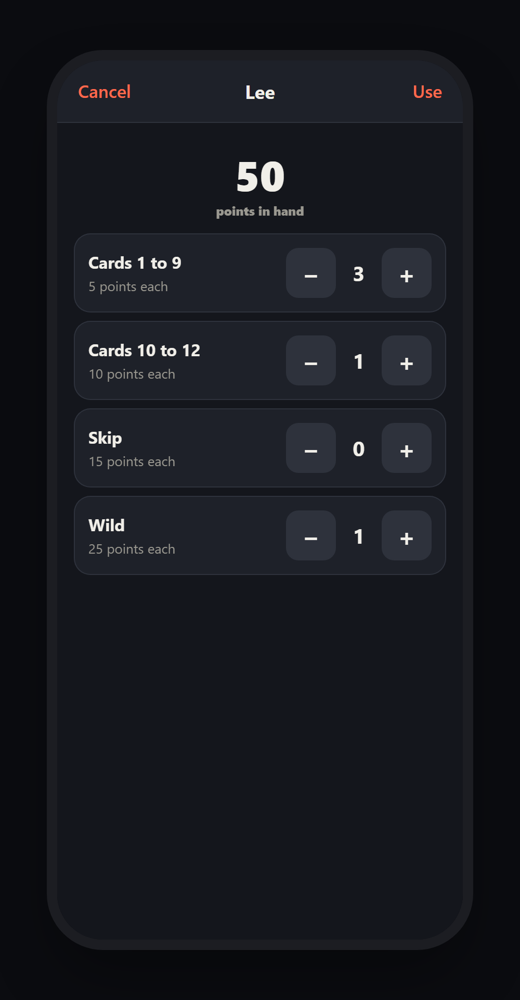
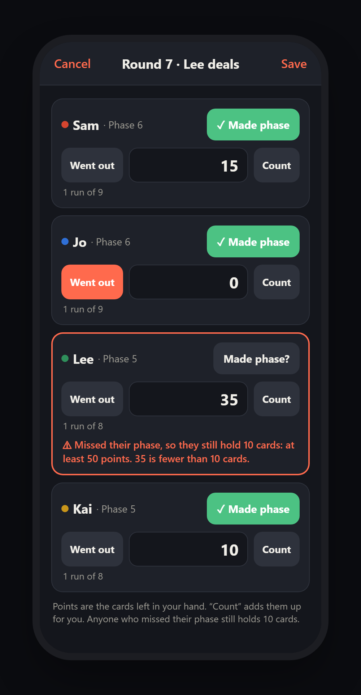

  

<h1 align="center">Phase Ten Scorekeeper</h1>

  <b>The score sheet for Phase 10*, on your phone, tablet or computer. No paper, no pencil, no internet needed.</b>

  <a href="https://nxlx-systems.github.io/nxlx-phase-scorekeeper/"><b>Open the app</b></a>
  &nbsp;·&nbsp;
  <a href="#install-it">Install it</a>
  &nbsp;·&nbsp;
  <a href="https://nxlx.gumroad.com/l/phase-ten-scorekeeper">Support it on Gumroad</a>

  
  &nbsp;
  
  &nbsp;
  

---

## What it does

| | |
|---|---|
| 🏆 **Live scoreboard** | Everyone's phase, total points and the leader, sorted the way the rules rank players. |
| ✅ **Fast round entry** | One tap for "made phase", one tap for "went out", type the rest. |
| 🧮 **Card counter** | Tap in the cards left in a hand (1 to 9, 10 to 12, Skip, Wild) and it adds the points and counts the cards for you. |
| 🚦 **Catches mistakes** | A player who missed their phase still holds 10 cards, so the app flags anything under 50 points. It also flags points that aren't in 5s and totals no hand can reach. |
| 🃏 **Dealer tracking** | Shows who deals and who plays first, and passes the deal each round. |
| ✏️ **Fix mistakes** | Edit any past round from a clearly marked editing screen. |
| 📚 **Past games** | Finished games are kept, with every round. |
| 💾 **Backups** | Save your scores as a file, or copy them as text, and restore them on any phone. |
| ✈️ **Works offline** | Once it's installed it runs with no signal. |
| 🌗 **Light and dark** | Follows your device's setting. Works upright and sideways. |
| 🔒 **Private** | Scores stay on your device. No account, no tracking, no ads. |

## Install it

It runs in any up-to-date web browser. Installing it adds an icon and lets it work with no internet.

**iPhone or iPad**
1. Open **[the app](https://nxlx-systems.github.io/nxlx-phase-scorekeeper/)** in **Safari**.
2. Tap **Share**, then **Add to Home Screen**, then **Add**.

**Android**
1. Open the app in your browser (Chrome, Firefox, Samsung Internet and others).
2. Open the browser's menu (**⋮**), then **Install app** or **Add to Home screen**.

**Computer (Windows, Mac, Linux, Chromebook)**
- **Chrome or Edge:** click the install button at the right of the address bar, or choose **Install** in the browser's menu.
- **Safari on a Mac:** choose **File**, then **Add to Dock**.
- Any other browser: just bookmark it. It still works, and still keeps your scores.

Whichever device you use, open it once while online after installing. From then on it works without internet.

## How to use it

1. **Set up a game.** Enter the players in seating order and pick who deals first.
2. **After each hand**, tap **Score round**. For each player, tick **Made phase** and enter the points left in their hand (or tap **Went out** for 0). Use **Count** to add up a hand. If a number can't be right, that player's row turns red and says why; you can still save anyway for house rules.
3. **Save.** The scoreboard updates and the deal moves to the next player.
4. When someone finishes phase 10, the app names the winner and offers a new game.

  
  &nbsp;
  

## Updates

The app checks for a newer version when you're online and shows an **Update available** bar. Tap **Update now** to get it. Your scores are never touched by an update, and a safety copy is saved first. You can also check any time from **Menu, then Check for updates**.

## Privacy

Everything is stored on your own device, in the browser's storage for this site. Nothing is sent anywhere. If you remove the app or clear your browser's website data, the scores go with it, so use **Menu, then Back up scores** now and then.

## Support

The app is free. If it saves you a pencil, you can [pay what you want on Gumroad](https://nxlx.gumroad.com/l/phase-ten-scorekeeper). Questions or ideas: open an [issue](https://github.com/nxlx-systems/nxlx-phase-scorekeeper/issues).

## Licence

The code is shared under the **[PolyForm Noncommercial License 1.0.0](LICENSE.md)**. You may use, study and change it for any noncommercial purpose, including personal use and use by charities, schools and public bodies. Selling it, or using it to make money, needs written permission from NXLX.Systems. The name Phase Ten Scorekeeper and the app icon are not covered by the licence.

---

  Made by <b>Anthony Giglio · NXLX.Systems</b>, Saskatoon 
  <a href="https://nxlx.gumroad.com">Shop</a> · <a href="https://instagram.com/nxlx.systems">Instagram</a>

* Phase 10 is a trademark of Mattel, Inc. Phase Ten Scorekeeper is an independent score-keeping tool made by NXLX.Systems. It is not affiliated with, sponsored by or endorsed by Mattel. You need your own copy of the card game to play.
